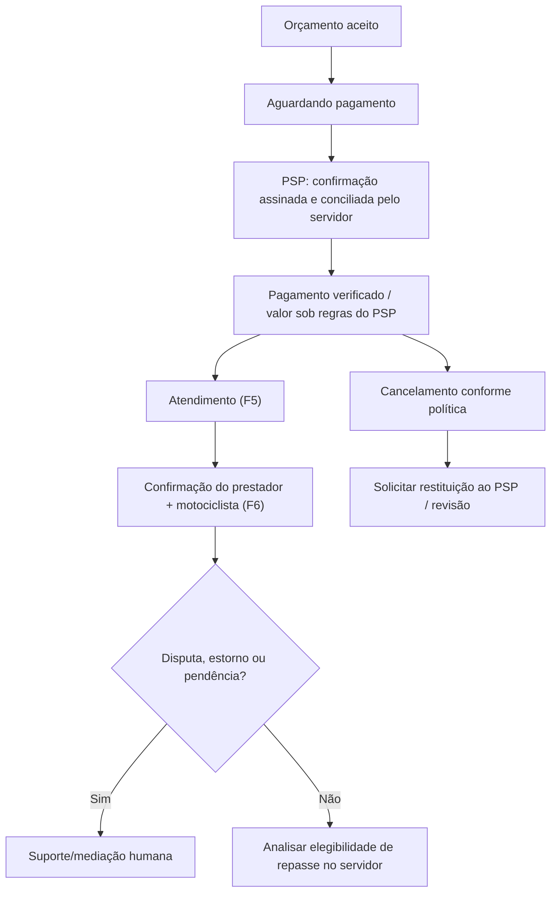

# F4 — Pagamentos protegidos, comissões e estornos (pré-implementação segura)

**Projeto:** Salva Motoca! · **branch:** `feat/f4-pagamentos-protegidos-simulador-seguro` · **dependências:** PR #42 (F2) e PR #44 (F3).

**Estado:** regras financeiras e preparação offline. Nenhum checkout, token, conta, cobrança, pagamento, transferência, saldo, reembolso, webhook real ou obrigação contratual foi criado.

## Decisões financeiras já aprovadas

- Taxa de **10% do motociclista** e comissão de **10% do prestador**, ambas somente sobre o valor do(s) serviço(s). Deslocamento e tarifa de processamento não integram a base; materiais já estão incluídos no serviço.
- Cliente arca com a tarifa de processamento **quando juridicamente permitido e tecnicamente confirmado pelo PSP**; deve ser exibida separadamente, antes da confirmação. **Não fixar uma tarifa presumida**.
- Orçamento escolhido fica imutável; adicionais exigem novo orçamento, novo aceite e avaliação de diferença financeira.
- Cliente só pode ter confirmação financeira por **webhook/autorização no servidor com verificação de assinatura, valor, moeda, prestador e idempotência**, reconciliado com o provedor. Retorno do navegador ou sessão concluída na UI não habilitam prestação, chat, endereço exato ou deslocamento.
- Cancelamento pelo prestador: regra proposta de **reembolso integral ao cliente incluindo tarifa**. Cancelamento pelo cliente antes de início do deslocamento: mesma regra. Após deslocamento, reembolso passa por **mediação humana**, sem liberação automática de saldo.
- Repasse ao prestador somente após **confirmações bilaterais da conclusão**, ausência de disputa, liquidação/validação do pagamento e elegibilidade contratual. Mesmo se elegível, o módulo puro NÃO inicia transferência.

## Modelo de cálculo (exemplo exclusivamente fictício)

| Parcela | Exemplo |
| --- | ---: |
| Reboque (serviço) | R$ 230,00 |
| Deslocamento | R$ 40,00 |
| Materiais | Incluídos no serviço |
| **Orçamento aceito** | **R$ 270,00** |
| Taxa do motociclista + comissão do prestador: R$ 23,00 + R$ 23,00 | R$ 46,00 |
| Saldo econômico destinado ao prestador, **antes de tributos e demais obrigações** | R$ 247,00 |
| Tarifa de processamento | **Não definida**; depende de PSP e meio de pagamento |
| Total a pagar pelo motociclista | **Não definido** até confirmação do valor da tarifa |

A responsabilidade legal/contábil por eventuais impostos e despesas não é resolvida por esses cálculos; não confundir valor previsto com saldo disponível ou efetivamente repassado.

## Código e backend candidato em ambiente isolado

- `f4-finance.js` — módulo puro sem dependências ou rede: valida linhas de orçamento em centavos, calcula comissão sem incluir deslocamento/materiais, aceita tarifa apenas quando fornecida como valor confirmado, simula decisões de reembolso e condições de análise de repasse. Não confirma pagamento vindo do navegador.
- `tests/f4-finance.test.js` — testa cálculo, serviço misto, tentativa de adulteração, centavos, duplicatas, fraude por evento do navegador, cancelamentos, mediação e bloqueio de transferência.
- `config.js` — `f4PaymentsEnabled: false`. Nenhum componente de checkout foi adicionado; pagamentos permanecem proibidos mesmo que a F1/F2/F3 sejam ativadas em outro momento.
- `supabase/drafts/f4_financial_backend_candidate.sql` — rascunho de **banco financeiro estritamente local** (NÃO migration): gate F4 falso, tentativas fictícias privadas, recibos de eventos mock com ID único e lançamentos compensatórios imutáveis. Não existe coluna de saldo liquidado, tabela real de repasses, cobranças, reconciliação Stripe ou transição `paid` em `service_requests`.
- `tests/f4-stage-rls.sql` — PostgreSQL 17 descartável: AUTH/RLS, prévia do orçamento apenas ao cliente, comissão calculada das linhas persistidas, tentativa fictícia idempotente, recusa de valor/moeda adulterados, evento repetido e estorno, proteção do ledger e garantia de que `awaiting_payment` não muda.
- `f4-mock-webhook.js` + `tests/f4-mock-webhook.test.js` — verificador **HMAC fictício** `mock-v1`, exclusivamente offline, que demonstra janela temporal, alteração de conteúdo, replay, ordem dos eventos e proibição de marcar pagamento como real. **Não é compatível com Stripe nem substitui biblioteca oficial ou consulta ao PSP**. A inbox JavaScript é somente em memória; a versão SQL demonstra deduplicação persistente.
- `supabase/rollback/f4_only_if_empty.sql` + `tests/f4-rollback-guard.sh` — reversão apenas quando gate desligado e **sem dados financeiros**; testes comprovam recusa com gate ativo ou registro e que F1/F2 não são removidas.
- `.github/workflows/f4-tests.yml` — execução de testes de lógica, Chrome sem rede, PostgreSQL 17 isolado e regressões anteriores, sem acesso a PSP ou ao Supabase ativo.
- `tests/f4-concurrency-setup.sql` + `tests/f4-concurrency.sh` — teste de concorrência com duas sessões PostgreSQL tentando processar o mesmo ID de evento mock; somente um recibo e um lançamento devem sobreviver, enquanto a solicitação segue em `awaiting_payment`.
- `docs/F4_RESULTADOS_MODELO.md` — matriz auditável que distingue controles locais comprováveis de backup, migração real, PSP, documentação legal e homologação ainda pendentes.
- `supabase/drafts/f4_double_entry_mock_candidate.sql` — **extensão exclusivamente local** com diário mock de partidas dobradas. Para um pagamento fictício de R$ 280,00: débito `mock_psp_clearing` R$ 280; crédito `mock_provider_payable` R$ 245,50; crédito `mock_platform_commission` R$ 34,50. Estorno integral inverte as três contas. Um trigger diferido exige, no commit, quantidade de linhas, contas, valores e equilíbrio exatos.
- `tests/f4-double-entry.sql` — prova contas balanceadas, idempotência contábil, lançamento compensatório de estorno, bloqueio de elegibilidade por disputa, tentativa de journal vazio e proibição de editar/apagar partidas.
- `supabase/rollback/f4_double_entry_only_if_empty.sql` e `tests/f4-double-entry-rollback-guard.sh` — rollback **apenas** da extensão contábil, negado com gate ligado ou entradas existentes, sem apagar tentativas fictícias da camada F4 anterior.

## Provedor de pagamentos: pesquisa técnica, sem conexão comercial

A documentação atual do Stripe Connect descreve marketplaces com cobrança pela plataforma e `separate charges and transfers` ou `destination charges`, conforme compatibilidade. Isso é um **caminho a investigar**, não decisão técnica ou contratação.

A Stripe informa expressamente que **não presta serviço de escrow**. Payouts manuais podem ter prazos máximos conforme o país e disponibilidade da conta, portanto não devem ser descritos como custódia indefinida. Não construir a política de mediação supondo que a Stripe guardará fundos por tempo ilimitado.

- [Stripe — Build a marketplace](https://docs.stripe.com/connect/marketplace)
- [Stripe — Using manual payouts (não é escrow)](https://docs.stripe.com/connect/manual-payouts)

**Antes de usar Stripe ou qualquer PSP:** confirmar suporte efetivo ao CNPJ brasileiro, modalidade Connect/Marketplace, métodos Pix/cartão disponíveis, estrutura de contas conectadas, disponibilidade de `separate charges and transfers`, responsabilidade por chargebacks, prazos máximos, repasses, estornos incluindo tarifas, impostos, contratos, LGPD e custos. A tarifa ao cliente depende de revisão jurídica e financeira brasileira. Não criar conta, produto, preço, PaymentIntent, Checkout Session ou transferência nesta etapa.

## Modelo de estados proposto para futura integração

**Sem webhook validado: continuar em `awaiting_payment`.** Falhas e retries não podem criar cobrança, estorno ou repasse duplicado. A confirmação de pagamento não se baseia em campo que o cliente possa escrever no Supabase.

## Dependências e critérios impeditivos

1. F1–F3 homologadas, com backup restaurável real (DB/Auth/Storage) antes de qualquer DDL remoto.
2. Forma jurídica e cadastral da empresa e prestadores, termos de contratação e política financeira revisados.
3. Escolher PSP com prova contratual de suporte aos métodos e à retenção/transferência desejada no Brasil.
4. Segredos, credenciais, verificações de webhook, idempotência e reconciliação no servidor — nunca no frontend, nunca no GitHub.
5. Ledger financeiro de partidas/lançamentos auditáveis, idempotência persistente e máquina de estados resistente a concorrência; API de transferência autenticada e aprovada por regra de negócio.
6. Fluxo de consentimento, confirmação clara de preço total, taxa, reembolso e custos da operação, sem surpresas.
7. Cenários adversariais de webhooks assinados, duplicados, atrasados, fora de ordem, chargeback, devolução, perda de rede, estorno parcial e disputa, exclusivamente em sandbox isolado e após autorização apropriada.
8. Sem pagamento real, o chat e rastreamento da F5 continuam fechados.

### Distinção entre demonstração contábil e provedor de pagamentos

O diário de partidas dobradas representa uma **obrigação econômica teórica**, não dinheiro possuído, sob custódia, disponível para repasse ou liquidado pelo PSP. A conta `mock_psp_clearing` é ficção contábil para testes. O banco só recebe eventos `mock_*`, usa assinaturas incompatíveis com Stripe e exige flag local de fixture. Mesmo a revisão de repasse positiva devolve `transferAuthorized=false` e requer confirmação humana, PSP e F6 real.

A versão futura deverá separar autorização, captura, disponibilidade, recebível do prestador, comissões efetivamente auferidas, tarifas reais do PSP, contas de suspense, diferenças, chargebacks, estornos parciais, impostos, reservas e repasses. A contabilização de valores pré-liquidação dependerá da arquitetura contratual selecionada e de revisão contábil/jurídica.

### Risco financeiro, estorno parcial e revisão de repasses

A extensão `supabase/drafts/f4_risk_settlement_mock_candidate.sql` acrescenta **somente em PostgreSQL descartável** casos de estorno parcial/integral, disputas e chargeback para revisão; não executa reembolsos nem repasses. IDs idempotentes, `FOR UPDATE` e soma de solicitações pendentes impedem reservar valores superiores ao orçamento original sob concorrência. Um caso aberto suspende a intenção de revisão de repasse; o encerramento **não** reativa pagamentos automaticamente.

`tests/f4-risk-settlement.sql` valida isolamento, estados, estornos e bloqueios; `tests/f4-risk-race.sh` prova idempotência e teto de valores em sessões PostgreSQL simultâneas; `supabase/rollback/f4_risk_only_if_empty.sql` reverte somente com a extensão vazia e gate desligado. Veja `docs/F4_RISCO_ESTORNOS_E_REPASSES.md`.

**Conclusão:** F4 inclui regras financeiras, assinatura mock de eventos, diário fictício de partidas dobradas e fila privada de risco **testados localmente**. Não há dinheiro sob custódia, saldo confirmado nem checkout. A futura arquitetura de produção ainda exige PSP contratado e conciliado, contabilização de estornos parciais reais, chargebacks, limites de retenção, legislação e homologação. **Toda integração real segue bloqueada até revisão e autorização específicas.**

### Candidato Stripe — ensaio de protocolo

`f4-stripe-test-reconciliation.js` verifica assinatura usando SDK oficial em fixture, exige moeda BRL, tentativa, cliente, prestador, orçamento, total e contexto de plataforma de teste. Compara o evento com leituras independentes injetadas de PaymentIntent e Charge, rejeita captura incompleta, disputa, devolução e transferência automática. A opção de persistência transacional foi validada em banco descartável (#154); retenções persistentes (#155) e projeção administrativa (#156) também foram validadas. Nenhum recibo autoriza pagamento ou operação. SDK fixado para ensaio (não uma escolha de versão de produção), transporte de rede bloqueado nos testes. Não houve chamadas à API Stripe nem criação de objetos. Tarifa de R$ 7 usada nos testes é fictícia, não cotação. Próxima etapa: homologação autorizada em sandbox real dedicado ao Salva Motoca!.

### Pré-verificação de sandbox dedicado

O conector expôs uma conta em modo de teste da Bonecodesign, mas não demonstrou exclusividade para este projeto. Não foram consultadas transações nem criados objetos. O script `scripts/f4-stripe-sandbox-readonly.cjs` somente admite execução explícita fora de CI, com chave restrita de teste, conta esperada, confirmação de sandbox dedicado e versão API especificada via ambiente privado. Consulta somente GET /v1/account e /v1/balance, verifica país BR e livemode=false; retorna indicadores sem IDs, valores ou segredos. A camada interna também oferece leitura exata de uma intenção/cobrança com vínculo integral ao orçamento persistido; testes usam transporte injetado, sem rede. Não interpreta charges_enabled/payouts_enabled como prova de Connect, Pix, disponibilidade financeira ou elegibilidade contratual. A conta de teste dedicada e credenciais não foram aprovadas nem fornecidas; execução remota permanece bloqueada. Não usar dados de outros projetos, não publicar chaves, não contratar serviços. RELEASE=NO_GO.
